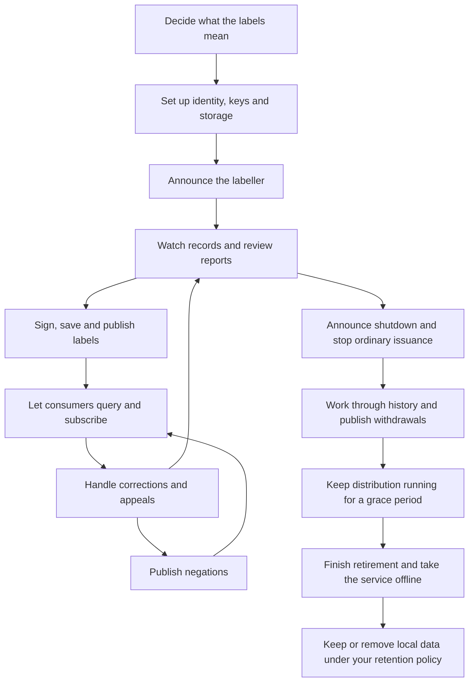
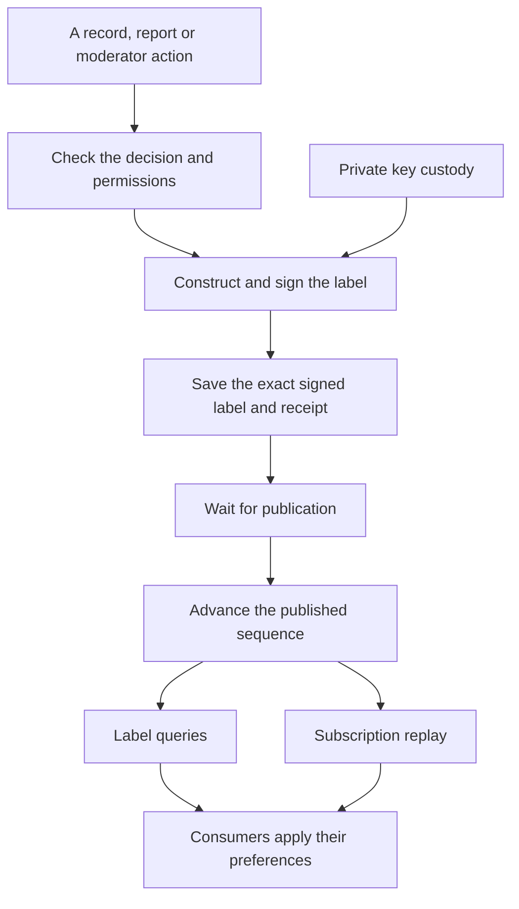

# What is a labeller?

A labeller is a service that attaches labels to accounts or records. You might use one to flag spam,
identify a particular kind of content, or point out that someone talks about beans. We'll get to the beans.

A **label** says who issued it, what account or record it describes, what the label is, and when it was
created. It can also include an expiry time, a record CID, or a flag that withdraws an earlier label.
Signing a label lets other applications check that its contents match the issuer's public key.

People choose which labellers to subscribe to and how their clients should respond. Your label doesn't
delete someone's post or suspend their account, and it doesn't make every client hide it.
That's the idea behind [composable moderation](https://docs.bsky.app/docs/advanced-guides/moderation):
different services can offer different judgements, and users decide which ones they want.

If you just want to read or verify labels from someone else's service, start with the [label APIs](../labels.md).
Here we're looking at what it takes to run your own.

The aim is to provide a **runnable labeller**. You write the decision logic that looks at Jetstream or
Firehose records and decides what to label. The labeller supplies the plumbing around it: signing,
storage, distribution, administration and shutdown. You'll still need to choose your policies and
configure your identity, keys and deployment.

> [!NOTE]
> This work is being built in stages. The signing APIs, shared issuance service, persistence and distribution packages are parts of that
> runnable service, not a finished host on their own. The walkthrough below describes the whole service,
> including the parts still to come.

## Meet the Bean Bureau

Let's imagine a labeller called the **Bean Bureau**. It watches Jetstream for posts about beans and
applies a custom `beans` label to their authors. Finally, a way to know who's been spilling them.

Your code looks at a post and decides whether its author qualifies. We're labelling the **author's DID**,
not the post's AT URI: the Bureau identifies accounts that talk about beans, rather than individual posts.
Ten bean posts shouldn't automatically mean ten identical account labels, so the issuance layer also
needs to know whether that author already has the label.

Once you've made the decision, the labeller signs the label, saves it, and makes it available to subscribers.
Its public declaration explains what `beans` means. People can then decide whether to subscribe.
The Bureau can't compel anyone to hide a baked-bean enthusiast.

The [shared issuance and withdrawal service](issuance.md) now handles those decision checks, target
resolution, signed labels and atomic audit/persistence. A host still supplies authentication,
authorization and policy implementations and identity/key management.
The [ASP.NET distribution host](hosting.md) supplies durable publication, queries,
subscriptions, health checks and metrics without requiring Ozone.

Of course, a keyword match raises questions. Do coffee beans count? Jelly beans? What happens when
someone appeals because they were discussing a Java bean? Let's follow the Bureau from its first
policy decision to the day it closes its tin for good.

## The life of a labeller

### 1. Decide what you're going to label

Before writing the detection code, decide what your labels mean. The Bean Bureau might label anyone
who posts about edible beans, but leave coffee and software components out of it. Write that down.
It'll help both your users and the moderator faced with an indignant coffee drinker.

Choose your label values and explain any custom ones to clients, including their intended severity
and presentation. Decide what evidence you'll need, whether labels should expire, and when you'll
review a decision. Be clear about what your automated rules can and can't reliably detect.

You'll also need to decide who can issue or withdraw labels, how people can report a problem or appeal,
and what records you'll keep. Publish your policies and contact information before asking people to
trust the Bureau.

### 2. Set things up and announce that you're open

Your labeller needs an identity and a dedicated signing key. Publish the public key as `#atproto_label`
in its DID document, and use the `#atproto_labeler` service entry to point consumers at your label endpoint.
Keep the private key somewhere safe, separate from the label database and from repository or OAuth keys.
Sort out backups and recovery before you have labels depending on that key.

Next, publish an `app.bsky.labeler.service` declaration record. This describes the labels you offer
and your labelling policy, including supported subject types and report reasons where applicable.
For the Bureau, this is where you explain the `beans` label.

There are three things to keep in step here. The declaration describes your service, the DID document
helps consumers find it and verify signatures, and the running host answers their requests.
Publishing a declaration doesn't start a server, and changing your server address doesn't update the DID document.

Check that queries and subscriptions work, publish your reporting and appeal routes, and tell people
you're open. They'll still need to choose to subscribe; announcing your labeller doesn't automatically
put it in every client's directory.

### 3. Start applying labels

Now your code can watch Jetstream or Firehose records and make decisions. Reports and moderator
investigations can lead to decisions too. A report asks you to look at something; it isn't an instruction
to apply a label without checking.

Suppose someone posts an enthusiastic defence of baked beans. Your rule approves a `beans` label for
the author's DID. The issuance layer checks the decision, chooses its timestamp and any optional fields,
and signs it. The signed label is saved with an operation identity so a retry doesn't accidentally
issue another batch.

After saving it, the labeller publishes it in order and makes it available through queries and subscriptions.
Consumers can check its signature and apply their own preferences. The signature tells them the contents
are authentic, not that the Bureau's judgement is correct. Even bean experts make mistakes.

### 4. Take a label back

Perhaps the post was about coffee after all. To withdraw the account's `beans` label, publish a signed
**negation** for the same issuer, subject and label value, with the appropriate record CID scope and
a timestamp that supersedes the original decision. The issuance layer works out that scope and ordering;
the database doesn't decide which labels cancel which.

A negation is a new statement, not an edit to the old label. Save and publish it through the same path
so consumers that saw the original can learn you've withdrawn it. Deleting a database row won't tell
anyone who already has a copy.

Expiry is different: it says when a label stops applying, rather than explicitly withdrawing a decision.
And deleting the bean post doesn't automatically withdraw an account label. You'll need a policy for that too.

### 5. Deal with reports and appeals

Give people a clear way to report something and a clear way to challenge your decisions.
If you accept protocol moderation reports, advertise the reasons you support accurately.
Label queries and subscriptions don't themselves handle reports or appeals; an appeal may come through
a separate review workflow.

For example, a coffee drinker might appeal their `beans` label. Keep track of the request, review the
evidence against your published policy, and have someone authorized decide the outcome.
Use independent review where your process calls for it. You might uphold the decision, publish a negation,
apply a different label, or ask for more information. Let the person know what happened through your
chosen communication channel.

Reports, appeals and their evidence aren't public labels. Keep the appropriate case and audit records,
but protect the people involved and don't put sensitive evidence in the signed-label history.
Those features need their own storage contracts. If an audit write must commit with a label, that needs
an explicitly supported transaction, not two unrelated database writes and crossed fingers.

### 6. Close the tin

If you're retiring the Bureau, tell people what's happening and how long distribution and review channels
will remain available. Stop ordinary issuance and take a fixed boundary of the history you'll work through.
Then decide which labels need withdrawing, sign the negations, and save your progress as you go.
Existing negations, expiry and later decisions matter here: don't blindly negate every historical entry.

Once all those withdrawals are published, keep queries and subscriptions running for a **grace period**.
This gives disconnected consumers an opportunity to catch up. You choose the duration; AT Protocol doesn't
mandate one, and waiting doesn't prove everyone has received the withdrawals.
Saving a deadline in the database won't keep your host running or finish retirement for you.

After the grace period, explicitly complete retirement, take the service offline, and update discovery
and public information to match. Think carefully before removing public verification keys: consumers may
still need them to check historical labels against the current DID document.
Destroying a private key is a separate decision, not something a database purge does.

Finally, follow your retention and backup policies. If you've authorized local deletion, purge in batches
so you can resume after an interruption. Keep the stream identity and sequence high-water marks so old
positions can't be reused. Removing local history won't erase backups or copies held by other people.

## What's doing all this work?

You don't need a separate process for every row below, but each responsibility needs a home.

| Part | What it does |
| --- | --- |
| Identity and declaration | Tell people who the labeller is, where to find it, how to verify its labels and what those labels mean. |
| Decision logic | Your code examines Jetstream or Firehose records and decides what to label, alongside moderator and report-driven decisions. |
| Authorization and audit | Check who can do what and keep the appropriate history of their decisions. |
| Issuance and signing | Turn an approved decision into a signed label with the right subject, value, time and optional fields. |
| Persistence | Save exact signed labels, sequences, receipts and progress so a restart doesn't lose your work. |
| Publication and distribution | Make saved labels available in order, answer queries and let subscribers catch up. |
| Host and operations | Run the service, protect its keys and credentials, and handle monitoring, upgrades and backups. |
| Retirement | Work through withdrawals, keep distribution running for a while, and coordinate any later local purge. |

Here's the path for one decision:

Signing answers **what was issued**. Storage remembers it. The host makes it available to other applications.
Here, **publication** means the label is durably available for queries and replay, not that every subscriber
has received it. A notification can wake something up, but the saved history is what recovery relies on.

## Why do we need a database?

Signing gives you a statement in memory. Restart the process without saving it and you've lost the history
needed for queries and missed subscription events. Rebuilding it later isn't the same: changing timestamp
or CID text can break a signature, and signing the same contents again can produce different signature bytes.

You can also crash between saving a label and publishing it, or after a batch commits but before its caller
gets an acknowledgement. Saved publication progress lets you pick up the first case; an operation receipt
lets you recover the second without issuing the batch twice. Transactions coordinate writers, and permanent
sequences give readers somewhere stable to resume.

The same goes for retirement. You don't want a restart halfway through closing the Bureau to lose track
of which withdrawals you've published. Back up that progress along with the labels.

## What can I use today?

The existing [label APIs](../labels.md) provide models, signing and verification. The persistence packages
add storage contracts and SQLite, PostgreSQL and MySQL providers with the same guarantees.
They're the storage part of the runnable labeller, not the whole service.

Report processing, team authorization, audit, moderation UI, protocol hosting and key custody belong
to the other labeller workstreams. Separating them from persistence doesn't mean you'll have to build
them yourself just to supply your bean-detection rule.

The services built on top should use typed storage operations, not engine-specific SQL.
If a decision, permission check or audit write needs to commit with issuance, the provider contract
must support that transaction explicitly.

Next, let's look at [persistence](persistence.md): choosing a provider, saving labels, recovering after
a restart and backing things up. The [metrics reference](../metrics.md#idunnoblueskylabelerpersistence)
covers monitoring.
